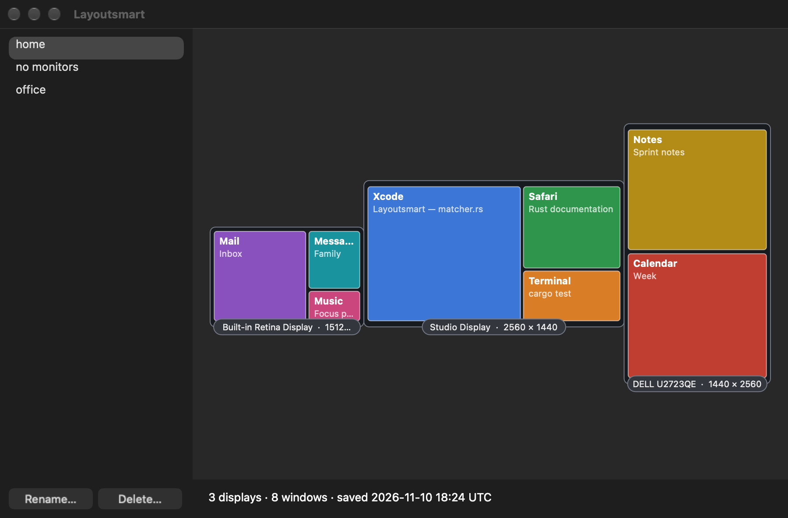

<p align="center">
  
</p>

<h1 align="center">Layoutsmart</h1>

<p align="center"><em>Outsmart your desktop.</em></p>

<p align="center">
  <a href="https://github.com/arrrlo/layoutsmart/actions/workflows/ci.yml"></a>
  <a href="https://github.com/arrrlo/layoutsmart/releases/latest"></a>
  <a href="LICENSE"></a>
  
  
</p>

Layoutsmart is a small macOS menu bar app that remembers where your windows are and puts
them back with one click. Plug in a different set of displays, watch macOS scatter
everything, then pick "home" or "office" from the menu and carry on.



## What it does

- **Save Window Positions…** stores the position and size of every open window under a
  name you choose: "home", "office", "no monitors", anything.
- **Click a profile** in the menu to move every window back to where that profile has it.
- **Dashboard** lists your profiles and draws each one: the displays, how they are
  arranged, and the windows on each. Rename or delete profiles there.
- **`layoutsmart` command** does the same from Terminal, for scripts and shortcuts.
- Starts when you log in and sits in the menu bar. No Dock icon, no window unless you
  ask for one.

It is deliberately manual: nothing moves until you click.

## Install

1. Download `Layoutsmart-<version>.pkg` from the
   [latest release](https://github.com/arrrlo/layoutsmart/releases/latest).
2. Double-click it. Because Layoutsmart is not signed with a paid Apple developer
   certificate, macOS will refuse the first time. Click **Done**, then open
   **System Settings → Privacy & Security**, scroll down and click **Open Anyway**.
3. Follow the installer. It puts Layoutsmart in Applications, adds the `layoutsmart`
   command, and starts the app. Nothing else needs to be installed.
4. macOS asks for **Accessibility** permission, which is what lets an app see and move
   other apps' windows. Switch on Layoutsmart under
   **System Settings → Privacy & Security → Accessibility**.

Prefer Terminal? This installs the same package without the Gatekeeper detour:

```sh
sudo installer -pkg ~/Downloads/Layoutsmart-*.pkg -target /
```

Requires macOS 13 or later, on Intel or Apple Silicon. Every build is installed and
started automatically on macOS 14, 15 and 26, on both kinds of Mac, before it is released.

### Uninstall

```sh
pkill -x Layoutsmart
sudo rm -rf /Applications/Layoutsmart.app /usr/local/bin/layoutsmart
rm -rf ~/.config/layoutsmart        # your saved profiles
```

Then remove Layoutsmart under System Settings → General → Login Items, and under
Privacy & Security → Accessibility.

## Using it

Click the icon in the menu bar:

| Menu item | What happens |
|---|---|
| **Save Window Positions…** | Asks for a name and saves the current layout. Using an existing name asks before replacing it. |
| *your profiles* | Click one to restore it. |
| **Open Dashboard…** | Shows every profile with a picture of its displays and windows. Rename and Delete are here. |
| **Quit Layoutsmart** | Stops the app until you open it again or log in. |

### Command line

```
layoutsmart <name> save          Save the current window positions as <name>
layoutsmart <name> restore       Put the windows back where <name> has them
layoutsmart restore              Restore the profile saved with the displays connected now
layoutsmart profiles             List saved profiles (* = saved with the current displays)
layoutsmart rename <old> <new>   Rename a profile
layoutsmart delete <name>        Delete a profile
layoutsmart list                 Show open windows and their positions
layoutsmart displays             Show connected displays
layoutsmart help | --version
```

The terminal app you run it from needs Accessibility permission too.

### Good to know

- Profiles are plain JSON files in `~/.config/layoutsmart/` (set `LAYOUTSMART_DIR` to use
  another folder). The file name is the profile name.
- Each profile remembers which displays it was saved with, so `layoutsmart restore`
  without a name can pick the right one.
- Windows are matched by app, then by title; windows whose title has changed (a browser
  showing a different page) are matched in the order macOS lists them.
- Minimised and full-screen windows are left alone, and so are apps that are not running.
- Layoutsmart never connects to the internet and collects nothing.

## Fast and light

Measured on an Apple Silicon MacBook Pro with three displays:

| | |
|---|---|
| Reading every open window | about 40 ms |
| Memory while idle | about 20 MB (about 32 MB once the dashboard has been opened) |
| CPU while idle | 0% — no timers, no polling |
| Size on disk | 2.4 MB for the app, 1.3 MB for the installer |

Asking another app about its windows takes macOS 10–25 ms per app, so Layoutsmart asks
all apps at the same time, and reads all of a window's properties in one request.

## Building from source

You need a Mac with Rust (the exact version is pinned in `rust-toolchain.toml`) and
Apple's command line tools.

```sh
cargo xtask bundle       # dist/Layoutsmart.app
cargo xtask pkg          # dist/Layoutsmart-<version>.pkg
cargo xtask help         # everything else
```

The layout of the code:

| Folder | What it holds |
|---|---|
| `crates/core` | Every decision: matching windows, profiles on disk, the dialogs' logic, the menu, the dashboard picture, the command line. Pure Rust, no `unsafe`. |
| `crates/macos` | The calls into macOS: Accessibility, displays, running apps. |
| `crates/app` | The two programs and the AppKit windows. |
| `xtask` | Build tasks: quality gates, app bundle, installer. |

## Contributing

Layoutsmart is built test-first, and the rules are enforced by `cargo xtask ci`, which is
also what CI runs:

| Gate | Requirement |
|---|---|
| Format and lints | `cargo fmt`, `cargo clippy` with warnings as errors |
| Tests | Pass as Apple Silicon and as Intel builds |
| Coverage | 100% of lines, regions and functions ([cargo-llvm-cov](https://github.com/taiki-e/cargo-llvm-cov)) |
| CRAP | No function above 10 ([cargo-crap](https://github.com/minikin/cargo-crap)) |
| Mutation testing | No surviving mutant ([cargo-mutants](https://mutants.rs)) |
| `lint-shell` | See below |

One-time setup:

```sh
cargo install cargo-llvm-cov@0.9.1 cargo-mutants@27.1.0 cargo-crap@0.9.0 --locked
```

**The one exception.** Code that only talks to macOS (`crates/macos`, `crates/app/src`
and the process launcher in `xtask/src/sh.rs`) cannot be unit-tested without driving a
real desktop, so it is left out of the coverage and mutation figures. In exchange it is
not allowed to decide anything: the CRAP gate scores it as 0% covered, which limits each
function to a single branch, and `lint-shell` forbids any branch inside the AppKit
callback methods. If you find yourself wanting an `if` there, the logic belongs in
`crates/core`, with a test.

That code is checked by `cargo xtask smoke`, which drives the real app through its menu
bar icon (it needs Accessibility permission for your terminal), and by CI installing the
finished package on five kinds of Mac.

Working method: write the test, watch it fail, write the least code that makes it pass,
tidy up, run `cargo xtask check`. Run `cargo xtask mutants` before you commit.

### Releasing

1. Set the new version in `Cargo.toml` (`[workspace.package]`) and commit.
2. Tag it `v<version>` and push the tag.

CI then runs every gate, builds the installer, installs and starts it on each supported
macOS version, and publishes a GitHub release with the `.pkg` and its checksum.

## Licence

[MIT](LICENSE)
